<div class="dos ancha-izq">
<div>

# Del curso a la práctica

### Un issue real, de punta a punta, con el plugin `sdlc-ia`

<p style="font-size: 0.62em;"><b>sdlc-ia</b>: <i>Software Development Life Cycle</i> con IA, es
decir, el ciclo de vida del desarrollo de software asistido por inteligencia artificial.</p>

<p class="tenue">Base de Conocimiento · issue #54 · PR #55<br>26 de octubre de 2026</p>

</div>
<figure>
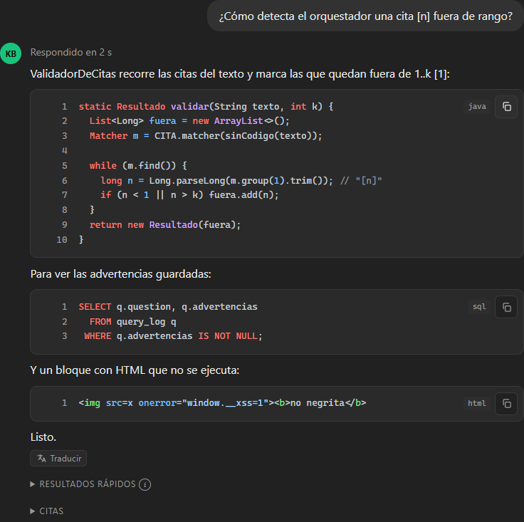
</figure>
</div>

Note:
Manuel, David: en estos minutos les muestro cómo llevo a la práctica lo que vimos en el curso. No
les traigo un ejemplo de juguete: es un issue real de la aplicación que trabajé en el curso, hecho
de punta a punta con el plugin sdlc-ia y siguiendo el proceso operacional paso a paso. La sigla
viene de Software Development Life Cycle: el ciclo de vida del desarrollo de software, aquí asistido
por IA. A la derecha está el resultado. Les voy a mostrar cómo llegué ahí.

---

## Lo que aprendí en el curso

<div class="dos ancha-der">
<div class="lista-corta" style="font-size: 0.8em;">

- **Desarrollo guiado**, no *vibe coding*: planear antes de construir.
- **Contexto en el repo**: `AGENTS.md`, ADRs, `architecture.md`, `business.md` y design
  tokens.
- **El CI como juez**: si las pruebas fallan, no hay merge, diga lo que diga el agente.
- **Make como catálogo de comandos**: un solo lugar para lo que se corre en local y en el CI; el
  mismo `make check` sirve en mi máquina, en el hook de git y en el pipeline.
- **Intención visual**: mostrar antes de pedir código.
- **Verificar y revisar**: navegador, revisión de código, humano al final.
- **Hooks como blindaje**: el control determinista no depende del agente.
- **Permisos a la vista**: saltárselos también salta los hooks.

</div>
<figure>
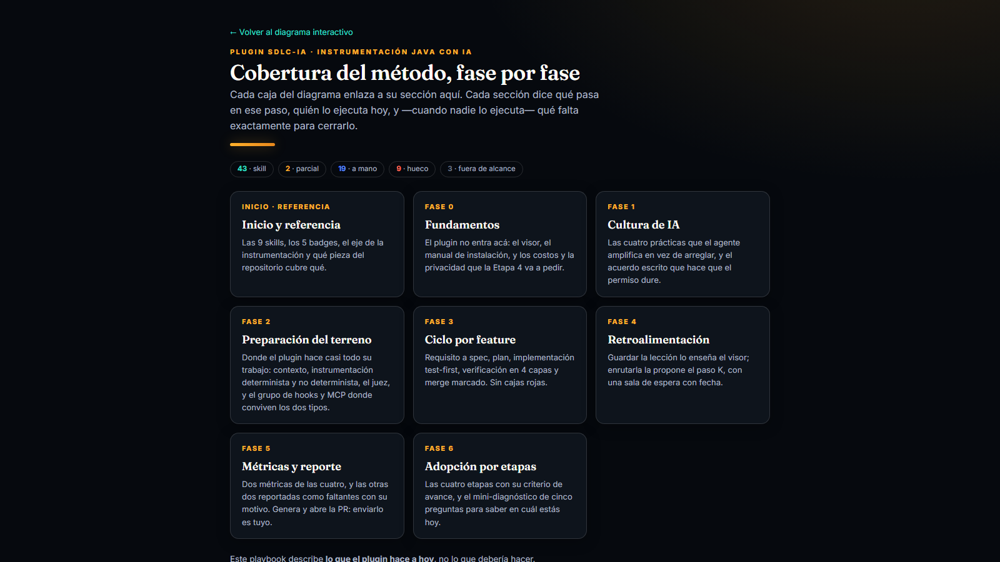
<figcaption>El playbook del taller: 7 fases y quién ejecuta cada paso hoy.<br>Fuente:
<a href="https://github.com/G3A/workshop-desarrollo-sw-guiado-por-ia/blob/dev/playbook-sdlc-ia/Playbook-Fases/index.html"
target="_blank"><code>playbook-sdlc-ia/Playbook-Fases/index.html</code></a></figcaption>
</figure>
</div>

Note:
En cinco sesiones aprendí un método, no una herramienta. Ocho ideas me quedaron: planear antes de
construir, poner el contexto en el repo, que el CI sea el juez, y usar make como catálogo de
comandos, para que el mismo make check corra en mi máquina, en el hook de git y en el pipeline.
También, mostrar la intención visual antes de pedir código, y verificar y revisar siempre. Las dos
últimas son de control: los hooks blindan al agente sin depender de él, y saltarse los permisos
también salta los hooks. A la derecha está el playbook que armé después del curso: las siete fases
del método y, para cada paso, quién lo ejecuta hoy.

---

## Lo que se actualizó después del curso

El cierre del Workshop de Desarrollo Guiado por IA fue el **19 de mayo de 2026**. Ese día usábamos
**4 skills**: `agent-context`, la única de `arkandia-skills`, y `linear-plan`,
`plan-phase-executor` y `fastapi` en el repo `campus`.
Después, Arkandia sumó **8**, y hoy conserva 6.

| Tema | En el curso | Hoy en Arkandia | Lo que llevé al taller |
|---|---|---|---|
| Contexto del agente | `AGENTS.md` a mano, luego `agent-context` | `agent-context-dotnet` (junio) | `agent-context-java` |
| Especificación | Spec Kit u OpenSpec | `requirement-to-spec` (agosto) | `requirement-to-spec-java` |
| Ticket → PR | `linear-plan` y `plan-phase-executor` en `campus` | `plan-and-build` (julio, con revisión adversarial) → `linear-plan-build` y `ado-plan-build` (agosto) | `github-plan-build` |
| Instrumentación | CI y hooks escritos a mano | `instrument-project-dotnet` e `instrument-agent-dotnet` (agosto) | `instrument-project-java` e `instrument-agent-java` |

<small>Fuentes: chats de las sesiones (abril y mayo de 2026), ramas `session-0N` de `campus` e
historial de [ArkandiaLabs/arkandia-skills](https://github.com/ArkandiaLabs/arkandia-skills):
v0.1.0 del 20 de abril → v0.5.0.</small>

Note:
El cierre del workshop fue el 19 de mayo. Ese día, el repositorio de Arkandia tenía una sola skill,
agent-context, y en el repo campus usábamos otras tres: linear-plan, plan-phase-executor y
fastapi. Desde junio, Arkandia sumó ocho y hoy conserva seis, para .NET, Azure DevOps y Linear. En
el taller las llevé a Java y GitHub; github-plan-build toma de Arkandia su ciclo de pasos, con la
revisión adversarial que llegó en julio.

---

## La aplicación: una base de conocimiento con citas

<p style="font-size: 0.7em;"><b>Brownfield, como requisito previo del workshop</b>: un repo Java
con Maven que ya existía, no un proyecto nuevo. Antes del issue tenía 118 clases Java, 38 clases de
prueba y 68 commits.</p>

<div class="dos">
<figure>
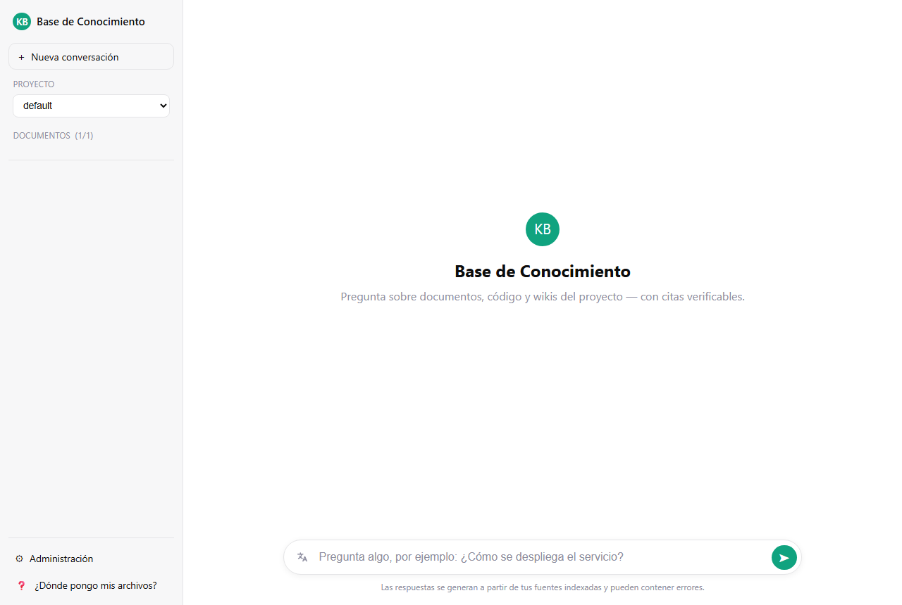
<figcaption>Pregunta sobre documentos, código y wikis del proyecto. 100 % local.</figcaption>
</figure>
<figure>
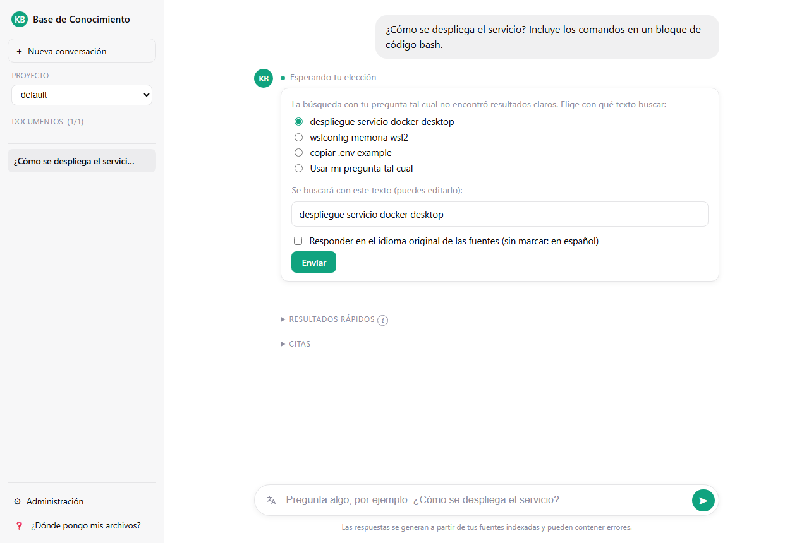
<figcaption>Si la búsqueda no convence, me deja elegir cómo reformularla.</figcaption>
</figure>
</div>

Note:
El requisito previo del workshop era trabajar sobre un repositorio brownfield, y eso hice: no armé
un proyecto de juguete para que todo saliera bien, sino que tomé uno que ya existía, con su código,
sus pruebas y su historia. Esta es la aplicación: un RAG en Java y Spring que responde sobre los
documentos del proyecto, con citas verificables y todo corriendo local, con Ollama en mi máquina.
Algo que me gusta es la derecha: cuando la búsqueda literal no encuentra algo claro, no inventa; me
propone reformulaciones y yo elijo con cuál buscar.

---

## Lo que vi al usarla: oportunidades de mejora

<div class="dos ancha-izq">
<figure>
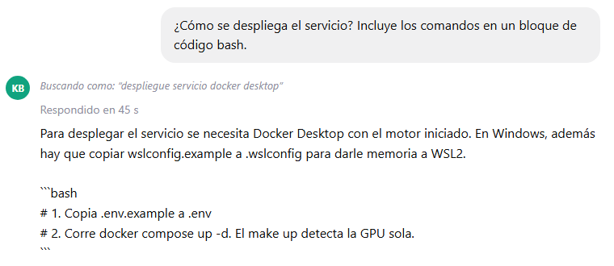
<figcaption>El código llega en crudo: con sus <code>```</code>, sin formato y sin forma de
copiarlo.</figcaption>
</figure>
<div class="lista-corta">

1. **El código sale en texto plano.** ← elegí este
2. El modelo escribió los comandos como comentarios.
3. La consola de admin muestra JSON crudo.
4. Errores de la consola que no se ven.
5. Contraste del tema claro bajo WCAG AA.

</div>
</div>

Note:
Al usarla encontré cinco cosas para mejorar. Las dos últimas salieron de una mesa redonda de
siete perfiles que armé para priorizar. Elegí la primera porque es la que más se nota: la base de
conocimiento también lee repositorios, así que las respuestas con código son normales, y hoy salen
así, con las marcas a la vista y sin poder copiar solo el código.

---

## El proceso que seguí

<figure>
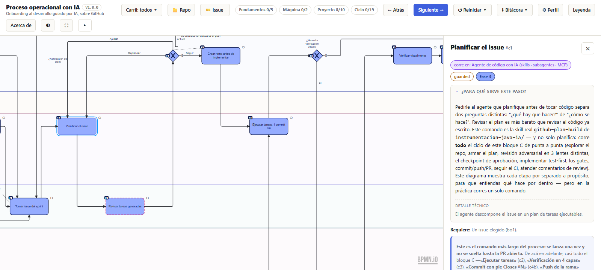
</figure>

<div class="franja">
<span class="yo"><b>Yo</b> · issue y mockups</span><span class="yo"><b>Yo</b> · elijo diseño</span>
<span><b>Skill</b> · plan</span><span class="yo"><b>Yo</b> · apruebo el plan</span>
<span><b>Skill</b> · rojo → verde</span><span><b>Skill</b> · verificación visual</span>
<span>
<b>Skill</b> · revisión y PR</span>
<span>
<b>CI</b> · juez</span>
<span class="yo">
<b>Yo</b> · merge</span>
</div>

<small>Fuente:
[`G3A/workshop-desarrollo-sw-guiado-por-ia/proceso-operacional-con-ia/`](https://github.com/G3A/workshop-desarrollo-sw-guiado-por-ia/tree/dev/proceso-operacional-con-ia)
· el visor es `proceso-operacional-con-ia.html`.</small>

Note:
Este es el visor del proceso operacional, tal como lo uso: el ciclo por issue, con el paso
«Planificar el issue» abierto; el panel dice qué corre y dónde decido yo. Abajo, el ciclo completo
resumido. En amarillo, lo que decidí yo: el issue, el diseño, aprobar el plan y el merge. En
azul, lo que corrió la skill github-plan-build. Y el CI es el juez que nadie puede saltarse. Ahora
recorro cada paso con su evidencia.

---

<span class="paso">Paso 1 · Tomar el issue y decidir la interfaz</span>

## Mockups antes de una línea de código

<div class="mockups">
<figure>
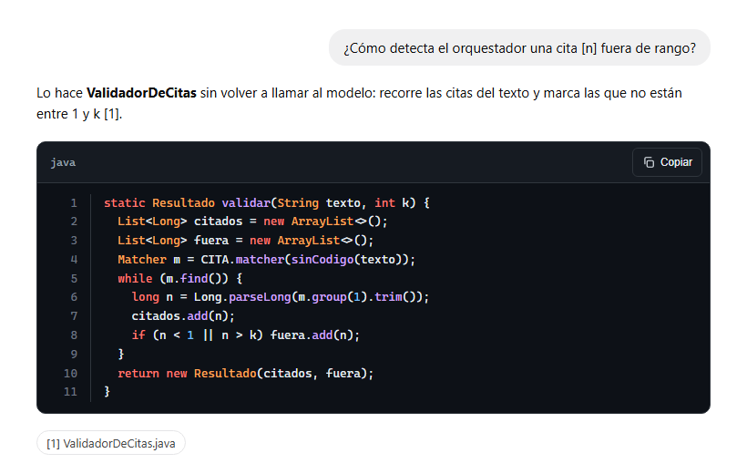
<figcaption><b>A · Bloque oscuro con barra</b><br>+ Se reconoce como código; copiar siempre
visible.<br>− En el tema claro es una mancha oscura.</figcaption>
</figure>
<figure class="elegida">
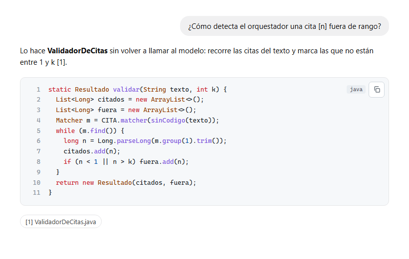
<figcaption><b>B · Sigue el tema, copiar flotante</b> (elegida)<br>+ El más liviano: se integra al
chat.<br>− El lenguaje se ve menos.</figcaption>
</figure>
<figure>
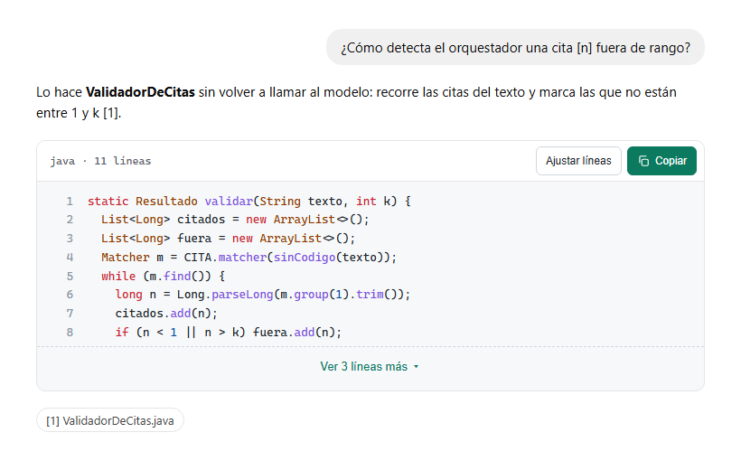
<figcaption><b>C · Barra completa y plegado</b><br>+ Varios bloques largos no hacen un muro.<br>−
Más controles y más código: el issue crece.</figcaption>
</figure>
</div>

<small>Del canvas «Código en el chat» (privado), con los pros y contras que acompañaron a cada
alternativa.</small>

Note:
Lo primero no fue código: fueron mockups. Lo aprendimos en la sesión de intención visual. Estas son
las tres alternativas, tal como las vi en el canvas. La A es un bloque oscuro con barra: se
reconoce de inmediato como código, pero en el tema claro es una mancha oscura. La B sigue el tema y
deja el copiar flotando: es la más liviana. La C suma «Ajustar líneas» y pliega los bloques largos,
pero agranda el issue. Abajo, cómo quedó la decisión.

--

<span class="paso">Paso 1 · Tomar el issue y decidir la interfaz</span>

## Mockups antes de una línea de código (parte 2)

<div class="dos ancha-der">
<div class="lista-corta">

- Tres alternativas en un canvas: **A** bloque oscuro, **B** sigue el tema, **C** con plegado.
- Elegí **B**: el menor cambio sobre el estilo actual.
- La decisión quedó **escrita en el issue**: el plan parte de ahí.

</div>
<figure>
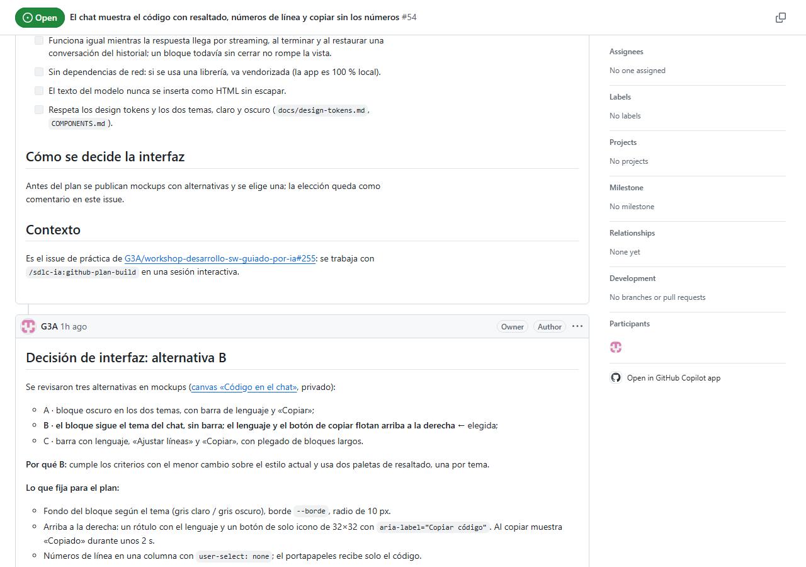
</figure>
</div>

Note:
Elegí la B, porque cumple todo con el menor cambio sobre el estilo del chat, y el plegado de la C
quedó fuera de alcance. Y la decisión no quedó en mi cabeza: quedó como comentario en el issue, y
el plan la tomó de ahí.

---

<span class="paso">Paso 2 · Planificar</span>

## El plan, antes que el código

<div class="dos">
<div class="lista-corta">

- `/sdlc-ia:github-plan-build 54` en sesión interactiva.
- El plan pasó por **3 revisiones adversariales**: convenciones, corrección y alcance.
  <small>No estaba en el curso: llegó de Arkandia en julio.</small>
- Mis decisiones: **highlight.js vendorizado** y un parser puro probado con `node --test`.
- Me dejó **9 supuestos a la vista** para aprobar o corregir.

</div>
<figure>
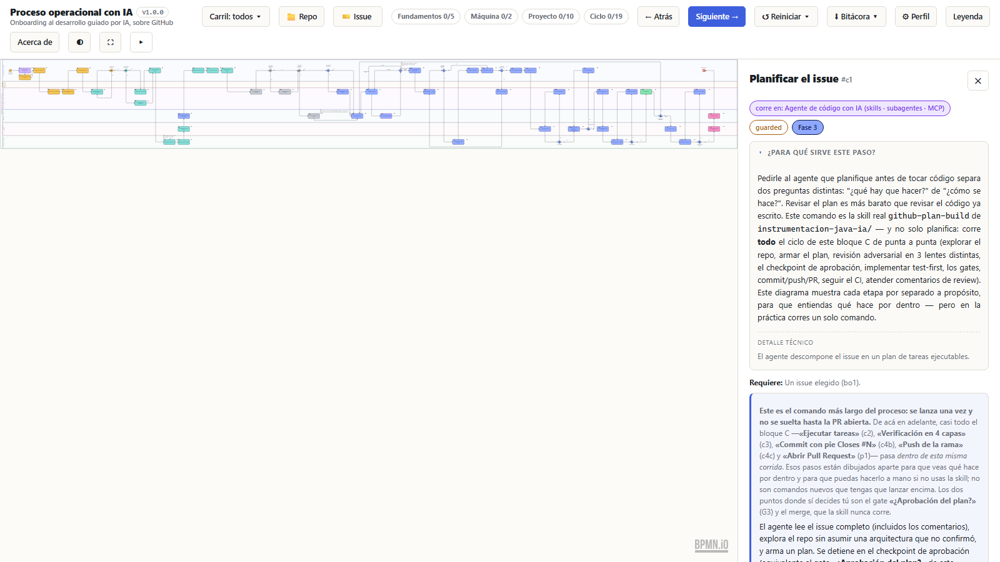
<figcaption>El nodo «Planificar el issue» del visor explica qué corre y dónde decido
yo.</figcaption>
</figure>
</div>

Note:
Lancé la skill con el número del issue. Antes de tocar código armó un plan y lo pasó por tres
revisiones adversariales —convenciones, corrección y alcance—, algo que no teníamos en el curso:
llegó en julio con las skills de planificación de Arkandia. Yo elegí highlight.js vendorizado,
porque la app no puede depender de internet, y un parser puro con sus pruebas; la skill dejó esas
decisiones escritas en el plan. Lo que más valoré: me puso nueve supuestos a la vista. Yo aprobé el
plan; sin eso no avanza.

---

<span class="paso">Paso 3 · Implementar, primero el rojo</span>

## Cuatro rojos antes del verde

<div class="dos ancha-izq">
<figure>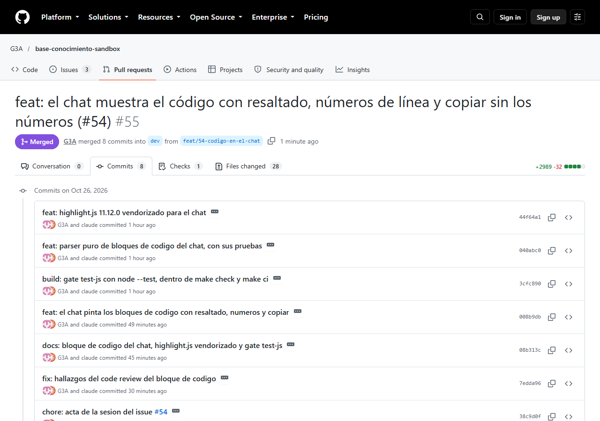</figure>
<div class="lista-corta">

Cada prueba falló **por la razón correcta** antes del arreglo:

1. No existe el parser de bloques.
2. Falla porque falta el módulo, no la prueba.
3. Un SQL sin lenguaje salía como CSS.
4. Sobraba una línea en blanco tras el bloque.

<small>Un commit por paso en verde, cada uno con su issue.</small>

</div>
</div>

Note:
Después, test first. Hubo cuatro rojos, y cada uno falló por la razón correcta. Por ejemplo, el
tercero: un bloque SQL sin lenguaje declarado se detectaba como CSS. La prueba lo atrapó antes de
que llegara a la pantalla. A la izquierda están los commits: uno por paso en verde, y cada uno
apunta a su issue.

---

<span class="paso">Paso 4 · Verificar visualmente</span>

## Lo que vio el navegador

<div class="rejilla">
<figure>
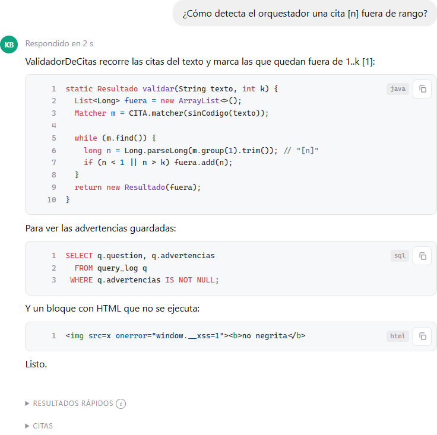
<figcaption>Tema claro: Java, SQL y un HTML que se muestra, no se ejecuta.</figcaption>
</figure>
<figure>

<figcaption>Tema oscuro: otra paleta de resaltado.</figcaption>
</figure>
<figure>
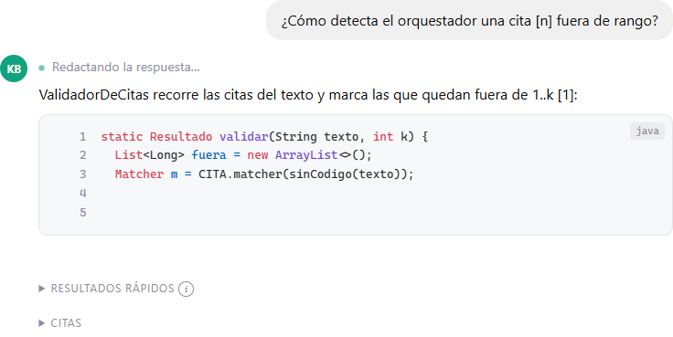
<figcaption>En streaming: el bloque crece y todavía no ofrece copiar.</figcaption>
</figure>
<figure>
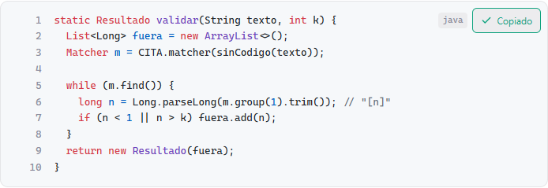
<figcaption>Copiar: confirma «Copiado» y no se lleva los números.</figcaption>
</figure>
</div>

Note:
El paso que aprendimos en la última sesión: verificar con el navegador. La skill reconstruyó la
app, sacó estas capturas con Playwright y las dejó como evidencia. Fíjense abajo a la derecha: el
botón confirma «Copiado», y en el portapapeles queda solo el código. Y arriba: un HTML malicioso
se muestra como texto, no se ejecuta.

---

<span class="paso">Paso 5 · Revisar, PR, CI y merge</span>

## El CI decide, yo hago el merge

<div class="dos ancha-der">
<div>
<div class="cifras" style="grid-template-columns: 1fr 1fr;">
<div><span class="cifra">8</span><small>commits</small></div>
<div><span class="cifra">28</span><small>archivos</small></div>
<div><span class="cifra">2m30s</span><small>CI en verde</small></div>
<div><span class="cifra">4 de 8</span><small>hallazgos de review corregidos</small></div>
</div>
</div>
<figure>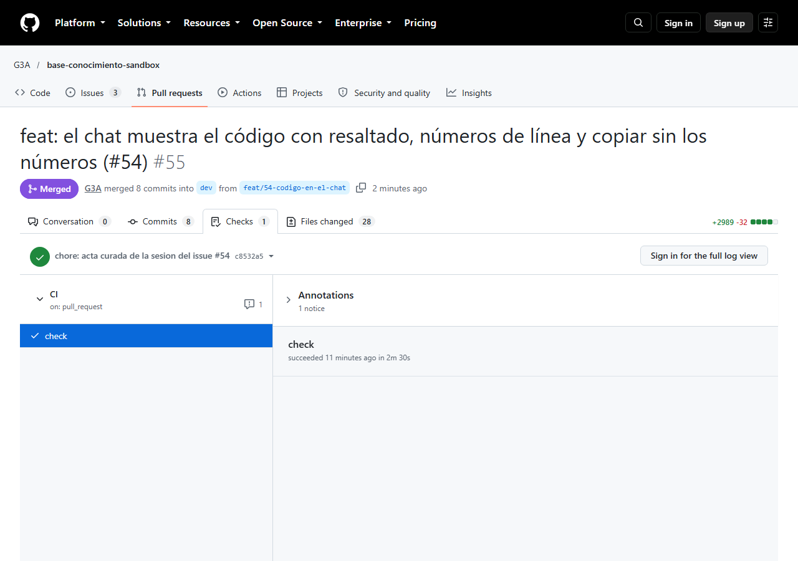</figure>
</div>

Note:
Antes de abrir la PR, la skill corrió una revisión de código: ocho hallazgos, corrigió cuatro y
argumentó por qué no los otros. La revisión de seguridad no encontró nada. Abrió la PR y el CI la
juzgó: lint, compilación, pruebas Java, las pruebas nuevas de JavaScript y el escaneo de
secretos, todo en dos minutos y medio. El merge lo hice yo. La skill nunca hace merge: esa
decisión es humana.

---

<span class="paso cursiva">Pasos 2 a 5 · Las pruebas</span>

## Qué probé, cómo y en qué momento

<div style="font-size: 0.82em;">

| Momento | Tipo de prueba | Con qué | Qué demostró |
|---|---|---|---|
| Plan (paso 2) | Cada criterio de aceptación con su verificación | Tabla «criterio → verificación» del plan | Ningún criterio quedó sin prueba |
| Implementar (paso 3) | Unitarias, prueba primero: 23 sobre el parser puro | `node --test` en `codigo.test.js` | 4 rojos por la razón correcta antes del verde |
| Implementar (paso 3) | Una restricción como prueba: la página no carga nada por la red | `node --test` sobre `index.html` | La app sigue 100 % local |
| Cada commit y push | Formato y secretos; en el push, `make check` completo | Lefthook: Spotless, gitleaks | Nada sale de mi máquina sin pasar los gates |
| Verificar (paso 4) | Visual, de punta a punta, contra la app levantada | Playwright: dos temas, streaming, historial, portapapeles | Copiar no se lleva los números; un HTML no se ejecuta |
| Revisar (paso 5) | Revisión de código y de seguridad | `/code-review` y `/security-review` | 8 hallazgos, 4 corregidos; seguridad sin hallazgos |
| PR (paso 5) | Regresión: 38 clases de prueba Java, con las reglas de arquitectura (ArchUnit), y las 23 nuevas | `make ci` en GitHub Actions | Verde en 2 min 30 s |

</div>

<small>Lo que no automaticé: la verificación con Playwright fue manual, porque depende del DOM y
de highlight.js; quedó como evidencia en el acta, no como prueba del CI.</small>

Note:
Hasta aquí mostré los pasos; esta diapositiva junta las pruebas en el orden en que ocurrieron. En
el plan, cada criterio de aceptación ya tenía su forma de verificarse. Al implementar, prueba
primero: veintitrés pruebas unitarias sobre el parser, con cuatro rojos antes del verde, y una
prueba que falla si la página carga algo de internet. En cada commit y en cada push, los hooks de
git corren formato, secretos y make check. Después, la verificación visual con Playwright contra la
app levantada. Antes de la PR, revisión de código y de seguridad. Y en la PR, el CI corre la
regresión completa: treinta y ocho clases de prueba Java, con las reglas de arquitectura, y las
nuevas de JavaScript. Lo que no automaticé: Playwright fue manual, y quedó como evidencia en el
acta.

---

<span class="paso cursiva">Los pipelines del sandbox</span>

## Qué corre cada pipeline y cuándo

<div style="font-size: 0.8em;">

| Cuándo | Dónde | Qué corre | Si falla |
|---|---|---|---|
| Al abrir la sesión del agente | Hook `SessionStart` de Claude Code | Barrido de dependencias con versiones nuevas (`versions:display-dependency-updates`) | Solo avisa |
| En cada acción del agente | Hooks `PreToolUse` y `PostToolUse` | Guard de secretos, comandos peligrosos, migraciones de Flyway, versiones fijadas fuera del BOM, log de auditoría | Bloquea la acción |
| En cada commit | Lefthook `pre-commit` | Spotless (formato Java) y gitleaks sobre lo que está en stage | No se crea el commit |
| En cada push | Lefthook `pre-push` | Enlaces de la documentación y `make check`: lint, build, pruebas Java y JavaScript | No sale el push |
| En cada PR y en cada push a `dev` | GitHub Actions `ci.yml`, job `check` (Ubuntu, JDK 25) | gitleaks verificado por checksum, `make ci` (lo de `make check` más `secrets`), enlaces; publica los reportes de las pruebas | La ruleset de `dev` exige el check en verde: no hay merge |
| Programado (nocturno) | — | **No hay ninguno todavía** para que ejecute las pruebas de integración o end to end | — |

</div>

<small>Fuentes: `.claude/settings.json`, `lefthook.yml`, `.github/workflows/ci.yml`, el `Makefile` y
la ruleset «dev - CI + revision» de
[G3A/base-conocimiento-sandbox](https://github.com/G3A/base-conocimiento-sandbox).</small>

Note:
Y estos son los pipelines que corren hoy en el sandbox, ordenados por momento. Al abrir la sesión,
un hook barre las dependencias y solo avisa. En cada acción del agente, los hooks bloquean lo que
no debe pasar: leer secretos, comandos peligrosos, tocar una migración ya aplicada. En cada commit,
formato y secretos; en cada push, make check completo. En cada PR, el CI corre make ci, y la regla
de la rama dev no deja hacer merge sin ese check en verde. Lo que no hay todavía es un pipeline
nocturno para que ejecute las pruebas de integración o end to end: nada corre programado.

---

## Antes y después

<div class="dos">
<figure>

<figcaption>
<b>Antes</b> · texto plano, con las marcas a la vista.</figcaption>
</figure>
<figure>
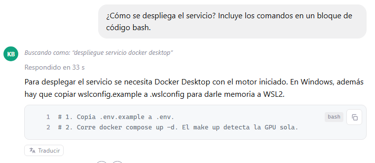
<figcaption>
<b>Después</b> · la misma pregunta: bloque resaltado, numerado y con copiar.</figcaption>
</figure>
</div>

<small>Estas dos son capturas mías de la app, antes de la sesión y después del merge, con el modelo
real: no están en el sandbox, porque el acta registra lo que hizo el agente, no cómo estaba la app
antes. Las que sacó la skill con Playwright sí están en el acta:
<a href="https://github.com/G3A/base-conocimiento-sandbox/tree/869ca5137eabda5b401d376e89cb3d564063a513/.ia/registros/54/evidencias"
target="_blank"><code>.ia/registros/54/evidencias/</code></a>.</small>

Note:
Y este es el resultado, con la misma pregunta. A la izquierda, cómo estaba esta tarde. A la
derecha, después del merge, con el modelo real respondiendo. Además, la conversación vieja del
historial también se ve formateada, porque el texto se guarda crudo y se pinta al mostrarlo.

---

## Cada principio del curso, una evidencia

| Lo que aprendí | Cómo lo apliqué | Evidencia |
|---|---|---|
| Planear antes de construir | Plan con 3 revisiones y 9 supuestos, aprobado por mí | [`docs/plans/plan-issue-54-…`](https://github.com/G3A/base-conocimiento-sandbox/blob/869ca5137eabda5b401d376e89cb3d564063a513/docs/plans/plan-issue-54-codigo-en-el-chat.md) |
| Contexto en el repo | Design tokens y `COMPONENTS.md` guiaron el diseño | [token nuevo `--bg-codigo`](https://github.com/G3A/base-conocimiento-sandbox/blob/869ca5137eabda5b401d376e89cb3d564063a513/docs/design-tokens.md#L28) |
| Intención visual | Mockups A/B/C y elección escrita | [comentario del issue #54](https://github.com/G3A/base-conocimiento-sandbox/issues/54#issuecomment-6427801024) |
| CI como juez | Gate nuevo `make test-js` en `make check` y `make ci`; sin SonarQube, porque no dispongo de un servicio: el análisis estático lo hacen Checkstyle y Spotless | [check en verde](https://github.com/G3A/base-conocimiento-sandbox/pull/55/checks) |
| Verificación visual | Capturas con Playwright en los dos temas | [5 capturas de evidencia](https://github.com/G3A/base-conocimiento-sandbox/tree/869ca5137eabda5b401d376e89cb3d564063a513/.ia/registros/54/evidencias) |
| Revisión de código | `/code-review` y corrección de hallazgos | [commit `7edda96`](https://github.com/G3A/base-conocimiento-sandbox/pull/55/commits/7edda96962a1e573ec69cc8977205804930e21c3) |
| Trazabilidad | Cada commit cita su issue | [`Refs #54` / `Closes #54`](https://github.com/G3A/base-conocimiento-sandbox/pull/55/commits) |

<div style="margin-top: 22px; padding: 14px 20px; border-radius: 12px; background: #fff4e0;
border: 1px solid #f0c47a; font-size: 0.62em; text-align: left;">
<b>Iniciativa propia, no del curso: el acta de la IA.</b> En mi empresa se audita de forma
constante contra ISO 9001 e ISO 27001. Por eso cada sesión del agente deja un registro versionado
en git (qué hizo, qué aprobé yo, con qué evidencia), y un verificador comprueba que llegue a la PR.
Acta de este issue:
<a href="https://github.com/G3A/base-conocimiento-sandbox/tree/869ca5137eabda5b401d376e89cb3d564063a513/.ia/registros/54" target="_blank"><code>.ia/registros/54/</code></a>.
</div>

Note:
Cada principio que vimos en clase dejó una evidencia que cualquiera puede revisar. Una aclaración
sobre el CI: no usé SonarQube, porque no dispongo de un servicio para correrlo; el análisis
estático lo hacen Checkstyle y Spotless, junto con las pruebas y gitleaks. Abajo, algo que
no viene del curso sino de mi trabajo: en mi empresa nos auditan constantemente contra ISO 9001 e
ISO 27001, así que construí el acta de la IA. De ella saqué los pasos de esta presentación; se la
muestro en la siguiente.

---

<span class="paso cursiva">Iniciativa propia</span>

## El visor del acta: la evidencia para un auditor

<figure>
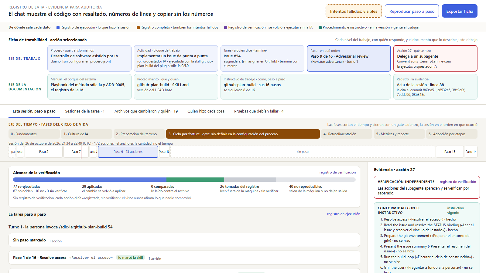
</figure>

<div class="comandos">

**Cómo verlo** — desde el clon de `base-conocimiento-sandbox`, un comando abre en el navegador el
visor del acta del issue #54, que está en
[`.ia/registros/54/`](https://github.com/G3A/base-conocimiento-sandbox/tree/dev/.ia/registros/54):

```text
make visor-acta ISSUE=54               # lo que registró la sesión
make visor-acta ISSUE=54 VERIFICAR=1   # antes la re-ejecuta sin la IA, en Docker (~1 min)
```

`VERIFICAR=1` repite cada acción del acta en un contenedor aislado (sin red, de solo lectura, sin
el modelo) y guarda el reporte junto al acta; el visor muestra qué coincidió y qué no.

**Lo que me marcó el visor** — la skill corrió los 4 rojos con un pipe al final; el primero fue:

```text
node --test "src/test/js/*.test.js" 2>&1 | tail -15
```

Un pipe devuelve el código de salida del último programa (`tail`, que termina en 0). La prueba
falló, pero el acta registró éxito y no puede demostrar el rojo. El rojo esperado va sin pipe.

</div>

Note:
Este es el visor del acta, pensado para un auditor. Para verlo basta un comando: make
visor-acta con el número del issue, y se abre en el navegador. Arriba, la ficha de
trazabilidad: quién hizo qué, en qué paso y qué documento lo gobierna. Abajo, cuánto se
verificó: setenta y siete acciones se volvieron a ejecutar sin la IA. Y no afirma lo que nadie
comprobó: la skill corrió mis cuatro rojos con un pipe, por ejemplo node --test sobre las
pruebas, redirigido a tail menos quince. El pipe devolvió el cero de tail: la prueba falló,
pero el acta registró éxito.

---

## Lo que aprendí haciéndolo

<p class="tenue">Ya no viene del curso: salió de lo último actualizado en el repo de Arkandia y de
mi trabajo con el plugin.</p>

<div class="dos lista-corta" style="font-size: 0.78em;">
<div>

### Qué puede hacer el agente y qué no

- **Las skills las invoco yo**: con `disable-model-invocation`, el agente no las lanza por su
  cuenta.
- **Las herramientas van por skill, no por sesión**: `allowed-tools` da permiso por adelantado
  solo a lo que `requirement-to-spec-java` necesita, y lo demás vuelve a quedar en manos de los
  permisos de la sesión.
- **Los permisos van por niveles**: `~/.claude` vale para mí en todos los repos; el `.claude/`
  del repo, para todo el equipo; `settings.local.json`, solo para mí en ese repo. Un `deny` en
  cualquier nivel gana.
- **Cada tarea, su modelo**: las skills que piden más criterio, como clasificar la deuda técnica o
  crear pruebas sobre código heredado, fijan `model: opus`.
- **Lo humano no se delega**: el diseño, el plan y el merge fueron decisiones mías.

</div>
<div>

### Lo que destapó la práctica

- **Los hooks sí protegen**: lo vimos en clase, y aquí lo comprobé: el guard de secretos frenó al
  agente cuando quiso leer un `.env`.
- **El acta destapó fallas de la propia herramienta**: cuatro en dos issues, cada una con su
  prueba.
- **Cada commit dice qué modelo lo escribió**: el trailer `Asistido-por-IA`.
- **El modo de permisos también es evidencia**: el acta muestra lo que se aprobó en *bypass*,
  sin que nadie lo aprobara.
- **Cada lección destapa la siguiente**: el rojo quedó registrado; ahora falta correrlo sin pipe.

</div>
</div>

<small>Mesa redonda de 7 perfiles y el issue anterior (#52): `mesa-redonda.md`.</small>

Note:
Esto ya no viene del curso: salió de lo que Arkandia actualizó después y de mi trabajo. La única
excepción son los hooks, que sí vimos en clase; aquí los comprobé en la práctica. A la izquierda,
cómo acoté al agente. Las skills del plugin no las puede lanzar él: las invoco yo con la barra. Cada
skill da permiso por adelantado solo a lo que necesita; no prohíbe lo demás. Los permisos van por
niveles: lo que pongo en la carpeta .claude de mi usuario vale para mí en todos los repos; la del
repo, para todo el equipo que lo clona; y el settings.local.json, solo para mí en ese repo. Por
encima de todos está la política de la organización. Si un nivel niega algo, ningún otro lo puede
permitir. Las de más juicio fijan el modelo. Y lo humano no se delega. A la derecha, lo que destapó
la práctica. Los hooks funcionan, como vimos en clase: el agente quiso leer un archivo de secretos y
lo frenaron. El acta encontró cuatro fallas en la propia herramienta, y las arreglé. Cada commit
dice qué modelo lo escribió. El modo de permisos también es evidencia: en bypass nadie aprueba, y el
acta lo muestra. Y cada lección destapa la siguiente: ahora toca correr el rojo sin pipe. Bajo a la
segunda parte.

--

## Lo que aprendí haciéndolo (parte 2)

<p class="tenue">Qué quedó determinista en el acta y qué no se pudo.</p>

<div class="hooks" style="font-size: 0.78em;">

| Hook | Qué hace, de forma determinista | No se pudo, y por qué |
|---|---|---|
| `SessionStart` | Anota el commit y el árbol de partida: la base contra la que se mide todo | Los comandos con `!`: los hooks no corren para lo que escribe la persona |
| `PreToolUse` | Antes de cada acción, guarda la herramienta, el hash de su entrada y el árbol de git | |
| `PostToolUse` y `PostToolUseFailure` | Después, el árbol que dejó la acción y sus evidencias, aunque haya fallado | Un fallo dentro de un pipe: el hook no recibe el código de salida de cada programa |
| `PermissionRequest` | Cada pedido de permiso, con su modo; lo empareja con su acción por el hash de la entrada | Quién aprobó en *bypass* o *auto*: no hay pedido, o lo resuelve el clasificador |
| `SessionEnd` | Compila el acta, busca secretos con gitleaks, la cura y la indexa | Verificar el razonamiento: el motor re-ejecuta sin la IA, así que el porqué no se repite |
| `commit-msg` (git) | Agrega al commit el trailer `Registro-IA` con la ruta del acta | |

</div>

Note:
Estos son los hooks que arman el acta, y qué hace cada uno. Al empezar, se anota el commit de
partida. Antes y después de cada acción, el árbol de git: así se ve qué cambió cada una. Cada
pedido de permiso queda con su modo. Al cerrar, se compila el acta, se buscan secretos, se cura y
se indexa. Y cada commit cita su acta. Fíjense en la columna de la derecha, lo que no se pudo: el
razonamiento no se verifica, porque el motor re-ejecuta sin la IA. En bypass o en auto no hay
pedido de permiso que registrar. Un pipe esconde el fallo, porque el hook no recibe el código de
cada programa. Y lo que yo escribo con signo de exclamación no pasa por los hooks.

---

## Roadmap

<p class="tenue">Lo que sigue, sobre lo que ya funciona.</p>

<div class="ruta">
<div>
<span class="etapa">1 · Próximo</span>

**Del acta a la ISO 9001**

El acta curada generará el **procedimiento**, el **instructivo de trabajo** y el **formato**.
Del formato saldrá el **registro en PDF** que pide el auditor.

</div>
<div>
<span class="etapa">2 · Después</span>

**De `sdlc-ia` a `adlc-ia`**

Cuando los agentes tomen más decisiones, la librería pasará de guiar el desarrollo a gobernar a
los agentes: ellos deciden, el acta lo registra.

</div>
<div>
<span class="etapa">3 · Visión</span>

**Una IA-Factory**

Con solo registrar un issue, cada paso que vieron correrá solo, de principio a fin. Si el cambio
es complejo, pasará por **revisión humana** antes de producción.

</div>
</div>

Note:
Cierro con lo que sigue. Primero, la ISO 9001: con el acta curada quiero generar los documentos
que pide la norma, el procedimiento, el instructivo de trabajo y el formato. Y de ese formato sale
el registro en PDF que le entrego al auditor. Después, evolucionar sdlc-ia a adlc-ia, cuando les
demos más protagonismo a las decisiones de los agentes. Y la visión: una IA-Factory. Registro un
issue y cada paso que les mostré hoy corre solo, de principio a fin, si el cambio es simple. Si es
complejo, un humano lo revisa antes de llegar a producción.

---

# Gracias

<div class="cifras">
<div><span class="cifra">1</span><small>issue de punta a punta</small></div>
<div><span class="cifra">9</span><small>pasos del proceso, con evidencia</small></div>
<div><span class="cifra">4</span><small>rojos antes del verde</small></div>
<div><span class="cifra">0</span><small>merges hechos por la IA</small></div>
</div>

<p class="tenue" style="margin-top: 32px;">
<a href="https://github.com/G3A/base-conocimiento-sandbox/issues/54">Issue #54</a> ·
<a href="https://github.com/G3A/base-conocimiento-sandbox/pull/55">PR #55</a> ·
acta en <code>.ia/registros/54/</code></p>

Note:
Cierro con cuatro números: un issue de punta a punta, nueve pasos del proceso con su evidencia,
cuatro rojos antes del verde y cero merges hechos por la IA. Todo está enlazado en esta
diapositiva. Gracias a Manuel y a David por todo lo que nos enseñaron en este workshop de
desarrollo de software guiado por IA. Quedo atento a su retroalimentación.
