<div class="dos ancha-izq">
<div>

# Del curso a la práctica

### Un issue real, de punta a punta, con el plugin `sdlc-ia`

<p class="tenue">Base de Conocimiento · issue #54 · PR #55<br>26 de octubre de 2026</p>

</div>
<figure>
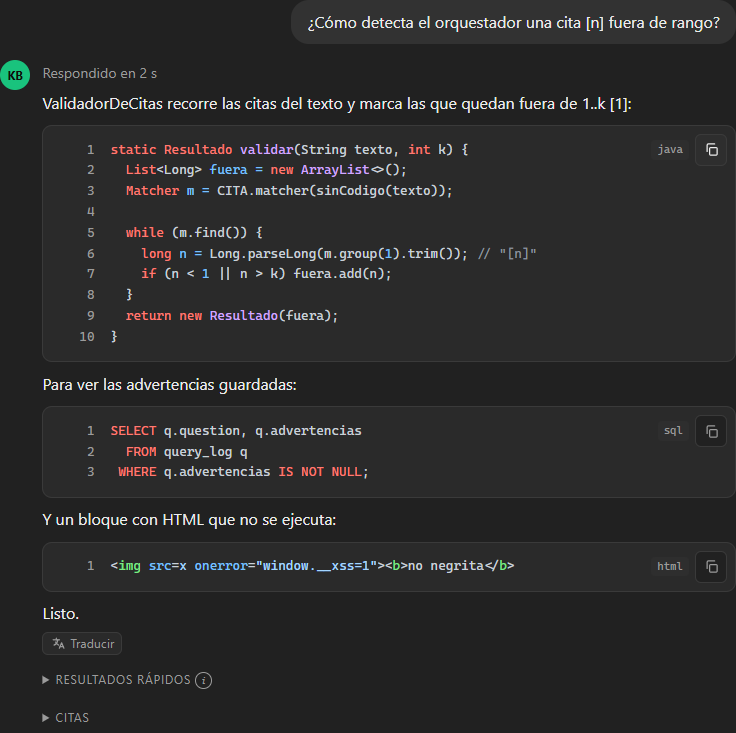
</figure>
</div>

Note:
Manuel, David: en estos minutos les muestro cómo llevo a la práctica lo que vimos en el curso. No
les traigo un ejemplo de juguete: es un issue real de la aplicación que trabajé en el curso, hecho
de punta a punta con el plugin sdlc-ia y siguiendo el proceso operacional paso a paso. A la derecha
está el resultado. Les voy a mostrar cómo llegué ahí.

---

## Lo que aprendí en el curso

<div class="dos ancha-der">
<div class="lista-corta">

- **Desarrollo guiado**, no *vibe coding*: planear antes de construir.
- **Contexto en el repo**: `AGENTS.md`, ADRs, design tokens.
- **El CI como juez**: lo determinista decide, no el modelo.
- **Intención visual**: mostrar antes de pedir código.
- **Verificar y revisar**: navegador, revisión de código, humano al final.

</div>
<figure>
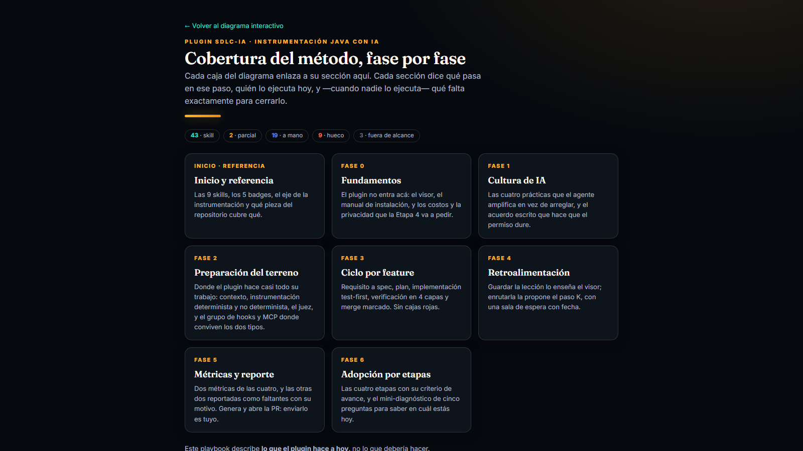
<figcaption>El playbook del taller: 7 fases y quién ejecuta cada paso hoy.</figcaption>
</figure>
</div>

Note:
En cinco sesiones aprendí un método, no una herramienta. Cinco ideas me quedaron: planear antes de
construir, poner el contexto en el repo, que el CI sea el juez, mostrar la intención visual antes de
pedir código, y verificar y revisar siempre. A la derecha está el playbook que armé después del
curso: las siete fases del método y, para cada paso, quién lo ejecuta hoy.

---

## Lo que se actualizó después del curso

Al cerrar el curso, el **5 de mayo de 2026**, usábamos **4 skills**: `agent-context`, la única de
`arkandia-skills`, y `linear-plan`, `plan-phase-executor` y `fastapi` en el repo `campus`.
Después, Arkandia sumó **8**, y hoy conserva 6.

| Tema | En el curso | Hoy en Arkandia | Lo que llevé al taller |
|---|---|---|---|
| Contexto del agente | `AGENTS.md` a mano, luego `agent-context` | `agent-context-dotnet` (junio) | `agent-context-java` |
| Especificación | Spec Kit u OpenSpec | `requirement-to-spec` (agosto) | `requirement-to-spec-java` |
| Ticket → PR | `linear-plan` y `plan-phase-executor` en `campus` | `plan-and-build` (julio, con revisión adversarial) → `linear-plan-build` y `ado-plan-build` (agosto) | `github-plan-build` |
| Instrumentación | CI y hooks escritos a mano | `instrument-project-dotnet` e `instrument-agent-dotnet` (agosto) | `instrument-project-java` e `instrument-agent-java` |

<small>Fuentes: chats de las sesiones (abril y mayo de 2026), ramas `session-0N` de `campus` e
historial de [ArkandiaLabs/arkandia-skills](https://github.com/ArkandiaLabs/arkandia-skills):
v0.1.0 del 20 de abril → v0.5.0.</small>

Note:
El curso terminó el 5 de mayo. Ese día, el repositorio de Arkandia tenía una sola skill,
agent-context, y en el repo campus usábamos otras tres: linear-plan, plan-phase-executor y
fastapi. Desde junio, Arkandia sumó ocho y hoy conserva seis, para .NET, Azure DevOps y Linear. En
el taller las llevé a Java y GitHub; github-plan-build toma de Arkandia su ciclo de pasos, con la
revisión adversarial que llegó en julio.

---

## La aplicación: una base de conocimiento con citas

<div class="dos">
<figure>
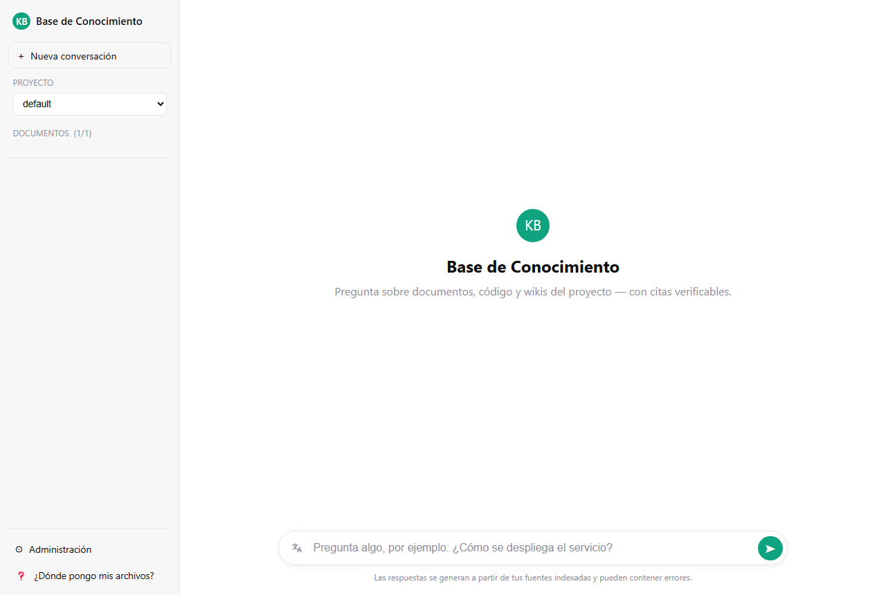
<figcaption>Pregunta sobre documentos, código y wikis del proyecto. 100 % local.</figcaption>
</figure>
<figure>
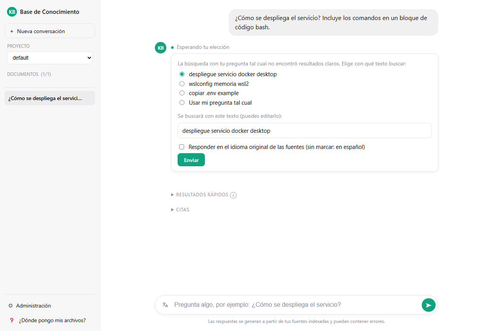
<figcaption>Si la búsqueda no convence, me deja elegir cómo reformularla.</figcaption>
</figure>
</div>

Note:
Esta es la aplicación: un RAG en Java y Spring que responde sobre los documentos del proyecto, con
citas verificables y todo corriendo local, con Ollama en mi máquina. Algo que me gusta es la
derecha: cuando la búsqueda literal no encuentra algo claro, no inventa; me propone reformulaciones
y yo elijo con cuál buscar.

---

## Lo que vi al usarla: oportunidades de mejora

<div class="dos ancha-izq">
<figure>
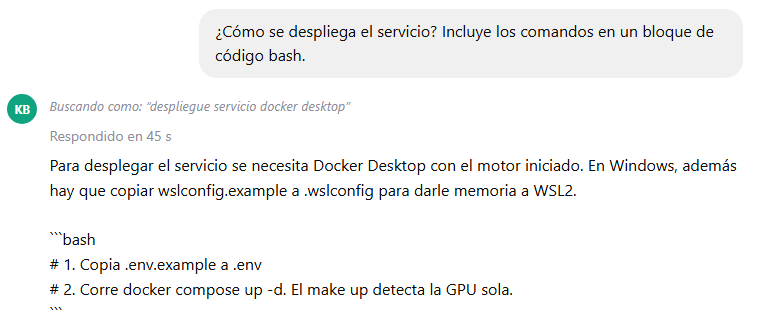
<figcaption>El código llega en crudo: con sus <code>```</code>, sin formato y sin forma de
copiarlo.</figcaption>
</figure>
<div class="lista-corta">

1. **El código sale en texto plano.** ← elegí este
2. El modelo escribió los comandos como comentarios.
3. La consola de admin muestra JSON crudo.
4. Errores de la consola que no se ven.
5. Contraste del tema claro bajo WCAG AA.

</div>
</div>

Note:
Al usarla encontré cinco cosas para mejorar. Las dos últimas salieron de una mesa redonda de
siete perfiles que armé para priorizar. Elegí la primera porque es la que más se nota: la base de
conocimiento también lee repositorios, así que las respuestas con código son normales, y hoy salen
así, con las marcas a la vista y sin poder copiar solo el código.

---

## El proceso que seguí

<figure>
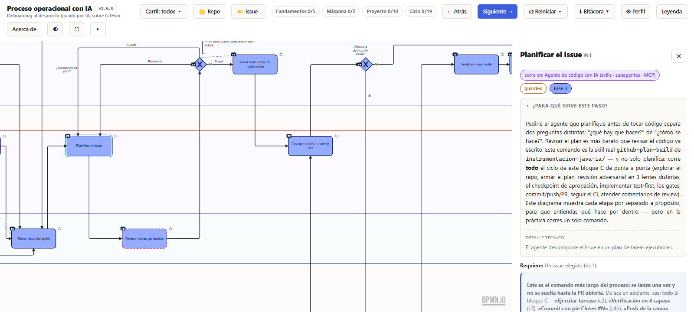
</figure>

<div class="franja">
<span class="yo"><b>Yo</b> · issue y mockups</span><span class="yo"><b>Yo</b> · elijo diseño</span>
<span><b>Skill</b> · plan</span><span class="yo"><b>Yo</b> · apruebo el plan</span>
<span><b>Skill</b> · rojo → verde</span><span><b>Skill</b> · verificación visual</span>
<span>
<b>Skill</b> · revisión y PR</span>
<span>
<b>CI</b> · juez</span>
<span class="yo">
<b>Yo</b> · merge</span>
</div>

<small>Fuente:
[`G3A/workshop-desarrollo-sw-guiado-por-ia/proceso-operacional-con-ia/`](https://github.com/G3A/workshop-desarrollo-sw-guiado-por-ia/tree/dev/proceso-operacional-con-ia)
· el visor es `proceso-operacional-con-ia.html`.</small>

Note:
Este es el visor del proceso operacional, tal como lo uso: el ciclo por issue, con el paso
«Planificar el issue» abierto; el panel dice qué corre y dónde decido yo. Abajo, el ciclo completo
resumido. En amarillo, lo que decidí yo: el issue, el diseño, aprobar el plan y el merge. En
azul, lo que corrió la skill github-plan-build. Y el CI es el juez que nadie puede saltarse. Ahora
recorro cada paso con su evidencia.

---

<span class="paso">Paso 1 · Tomar el issue y decidir la interfaz</span>

## Mockups antes de una línea de código

<div class="dos ancha-der">
<div class="lista-corta">

- Tres alternativas en un canvas: **A** bloque oscuro, **B** sigue el tema, **C** con plegado.
- Elegí **B**: el menor cambio sobre el estilo actual.
- La decisión quedó **escrita en el issue**: el plan parte de ahí.

</div>
<figure>
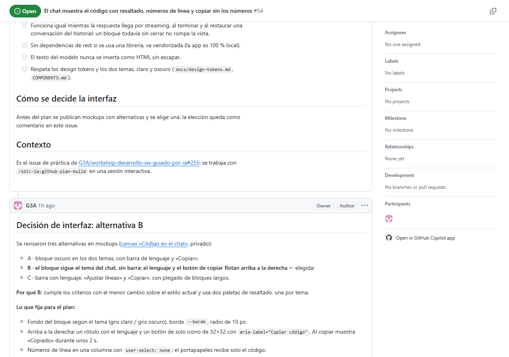
</figure>
</div>

Note:
Lo primero no fue código: fueron mockups. Lo aprendimos en la sesión de intención visual.
Publiqué tres alternativas, cada una con sus pros y contras, y elegí la B, porque cumple todo con el
menor cambio sobre el estilo del chat. Y la decisión no quedó en mi cabeza: quedó como comentario
en el issue, y el plan la tomó de ahí.

---

<span class="paso">Paso 2 · Planificar</span>

## El plan, antes que el código

<div class="dos">
<div class="lista-corta">

- `/sdlc-ia:github-plan-build 54` en sesión interactiva.
- El plan pasó por **3 revisiones adversariales**: convenciones, corrección y alcance.
  <small>No estaba en el curso: llegó de Arkandia en julio.</small>
- Mis decisiones: **highlight.js vendorizado** y un parser puro probado con `node --test`.
- Me dejó **9 supuestos a la vista** para aprobar o corregir.

</div>
<figure>
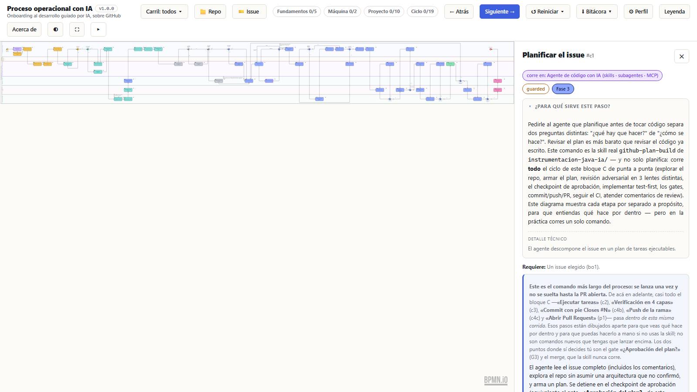
<figcaption>El nodo «Planificar el issue» del visor explica qué corre y dónde decido
yo.</figcaption>
</figure>
</div>

Note:
Lancé la skill con el número del issue. Antes de tocar código armó un plan y lo pasó por tres
revisiones adversariales —convenciones, corrección y alcance—, algo que no teníamos en el curso:
llegó en julio con las skills de planificación de Arkandia. Yo elegí highlight.js vendorizado,
porque la app no puede depender de internet, y un parser puro con sus pruebas; la skill dejó esas
decisiones escritas en el plan. Lo que más valoré: me puso nueve supuestos a la vista. Yo aprobé el
plan; sin eso no avanza.

---

<span class="paso">Paso 3 · Implementar, primero el rojo</span>

## Cuatro rojos antes del verde

<div class="dos ancha-izq">
<figure>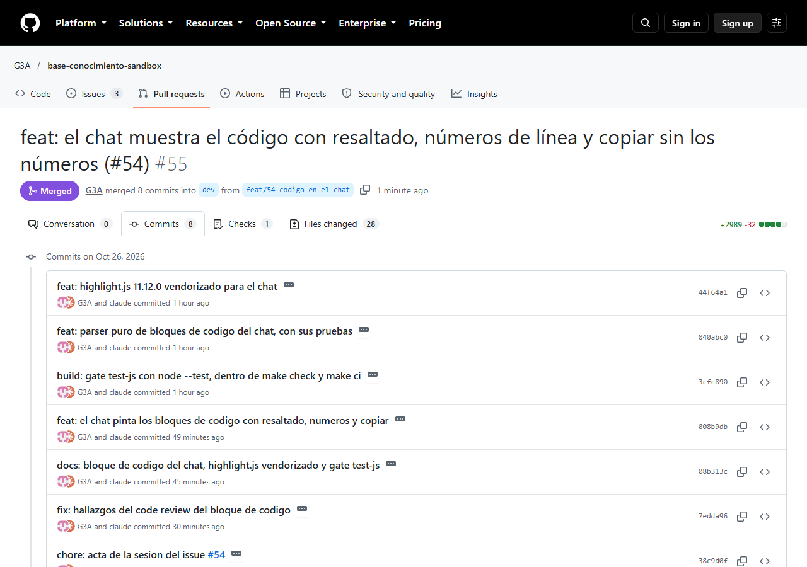</figure>
<div class="lista-corta">

Cada prueba falló **por la razón correcta** antes del arreglo:

1. No existe el parser de bloques.
2. Falla porque falta el módulo, no la prueba.
3. Un SQL sin lenguaje salía como CSS.
4. Sobraba una línea en blanco tras el bloque.

<small>Un commit por paso en verde, cada uno con su issue.</small>

</div>
</div>

Note:
Después, test first. Hubo cuatro rojos, y cada uno falló por la razón correcta. Por ejemplo, el
tercero: un bloque SQL sin lenguaje declarado se detectaba como CSS. La prueba lo atrapó antes de
que llegara a la pantalla. A la izquierda están los commits: uno por paso en verde, y cada uno
apunta a su issue.

---

<span class="paso">Paso 4 · Verificar visualmente</span>

## Lo que vio el navegador

<div class="rejilla">
<figure>
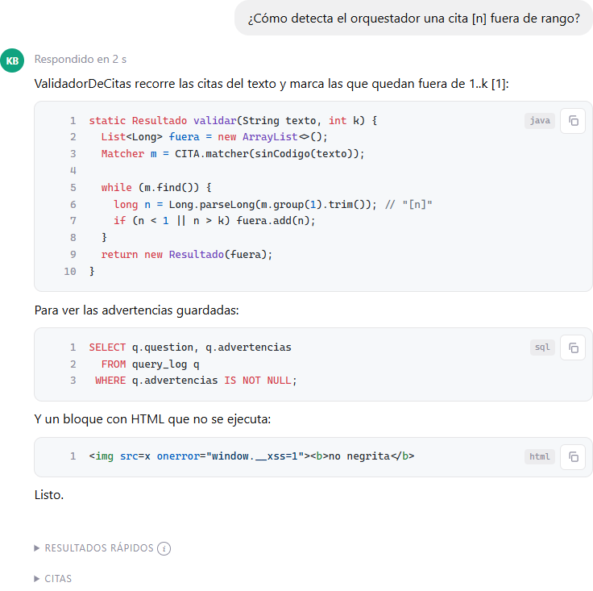
<figcaption>Tema claro: Java, SQL y un HTML que se muestra, no se ejecuta.</figcaption>
</figure>
<figure>

<figcaption>Tema oscuro: otra paleta de resaltado.</figcaption>
</figure>
<figure>
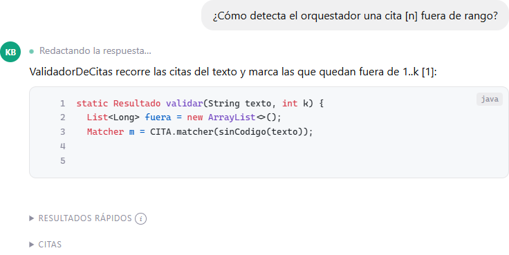
<figcaption>En streaming: el bloque crece y todavía no ofrece copiar.</figcaption>
</figure>
<figure>
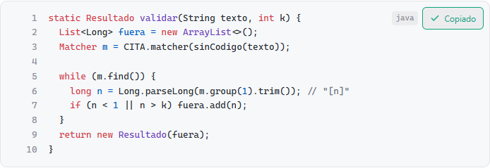
<figcaption>Copiar: confirma «Copiado» y no se lleva los números.</figcaption>
</figure>
</div>

Note:
El paso que aprendimos en la última sesión: verificar con el navegador. La skill reconstruyó la
app, sacó estas capturas con Playwright y las dejó como evidencia. Fíjense abajo a la derecha: el
botón confirma «Copiado», y en el portapapeles queda solo el código. Y arriba: un HTML malicioso
se muestra como texto, no se ejecuta.

---

<span class="paso">Paso 5 · Revisar, PR, CI y merge</span>

## El CI decide, yo hago el merge

<div class="dos ancha-der">
<div>
<div class="cifras" style="grid-template-columns: 1fr 1fr;">
<div><span class="cifra">8</span><small>commits</small></div>
<div><span class="cifra">28</span><small>archivos</small></div>
<div><span class="cifra">2m30s</span><small>CI en verde</small></div>
<div><span class="cifra">4 de 8</span><small>hallazgos de review corregidos</small></div>
</div>
</div>
<figure>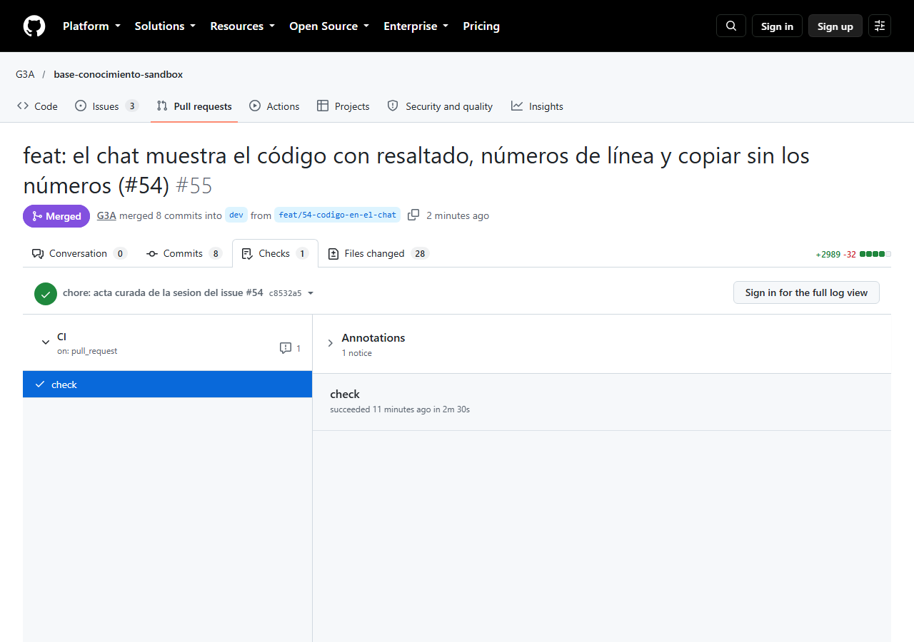</figure>
</div>

Note:
Antes de abrir la PR, la skill corrió una revisión de código: ocho hallazgos, corrigió cuatro y
argumentó por qué no los otros. La revisión de seguridad no encontró nada. Abrió la PR y el CI la
juzgó: lint, compilación, pruebas Java, las pruebas nuevas de JavaScript y el escaneo de
secretos, todo en dos minutos y medio. El merge lo hice yo. La skill nunca hace merge: esa
decisión es humana.

---

## Antes y después

<div class="dos">
<figure>

<figcaption>
<b>Antes</b> · texto plano, con las marcas a la vista.</figcaption>
</figure>
<figure>
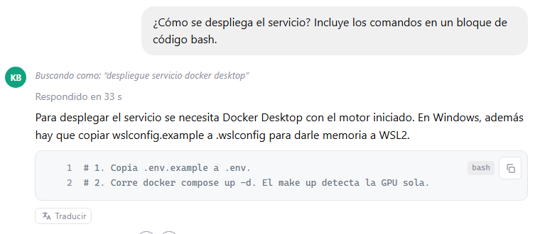
<figcaption>
<b>Después</b> · la misma pregunta: bloque resaltado, numerado y con copiar.</figcaption>
</figure>
</div>

Note:
Y este es el resultado, con la misma pregunta. A la izquierda, cómo estaba esta tarde. A la
derecha, después del merge, con el modelo real respondiendo. Además, la conversación vieja del
historial también se ve formateada, porque el texto se guarda crudo y se pinta al mostrarlo.

---

## Cada principio del curso, una evidencia

| Lo que aprendí | Cómo lo apliqué | Evidencia |
|---|---|---|
| Planear antes de construir | Plan con 3 revisiones y 9 supuestos, aprobado por mí | `docs/plans/plan-issue-54-…` |
| Contexto en el repo | Design tokens y `COMPONENTS.md` guiaron el diseño | token nuevo `--bg-codigo` |
| Intención visual | Mockups A/B/C y elección escrita | comentario del issue #54 |
| CI como juez | Gate nuevo `make test-js` en `make check` y `make ci` | check en verde |
| Verificación visual | Capturas con Playwright en los dos temas | 5 capturas de evidencia |
| Revisión de código | `/code-review` y corrección de hallazgos | commit `7edda96` |
| Trazabilidad | Cada commit cita su issue | `Refs #54` / `Closes #54` |

<div style="margin-top: 22px; padding: 14px 20px; border-radius: 12px; background: #fff4e0;
border: 1px solid #f0c47a; font-size: 0.62em; text-align: left;">
<b>Iniciativa propia, no del curso: el acta de la IA.</b> En mi empresa se audita de forma
constante contra ISO 9001 e ISO 27001. Por eso cada sesión del agente deja un registro versionado
en git (qué hizo, qué aprobé yo, con qué evidencia), y un verificador comprueba que llegue a la PR.
Acta de este issue: <code>.ia/registros/54/</code>.
</div>

Note:
Si lo resumo en una tabla: cada principio que vimos en clase dejó una evidencia que cualquiera
puede revisar. Abajo agrego algo que no viene del curso, sino de mi trabajo: en mi empresa nos
auditan constantemente contra ISO 9001 e ISO 27001, así que construí el acta de la IA. Cada sesión
del agente queda registrada en git, con lo que hizo, lo que aprobé yo y su evidencia, y un
verificador comprueba que llegue a la PR. De ahí saqué todos los pasos de esta presentación.

---

## Lo que aprendí haciéndolo

- **Los hooks sí protegen**: el guard de secretos frenó al agente cuando quiso leer un `.env`.
- **El acta destapó fallas de la propia herramienta**: cuatro en dos issues, cada una con su prueba.
- **Una lección aplicada se nota**: en el issue anterior el rojo no quedó registrado; esta vez, sí.
- **Lo humano no se delega**: el diseño, el plan y el merge fueron decisiones mías.

<small>Mesa redonda de 7 perfiles y el issue anterior (#52): `mesa-redonda.md`.</small>

Note:
Cuatro aprendizajes de hacerlo de verdad. Los hooks funcionan: el agente quiso leer un archivo de
secretos y lo frenaron. Entre este issue y el anterior, el registro de la sesión encontró cuatro
fallas en la propia herramienta, y las arreglé. En el issue anterior el rojo no quedó
registrado; esta vez sí, porque apliqué la lección. Y lo humano no se delega.

---

# Gracias

<div class="cifras">
<div><span class="cifra">1</span><small>issue de punta a punta</small></div>
<div><span class="cifra">9</span><small>pasos del proceso, con evidencia</small></div>
<div><span class="cifra">4</span><small>rojos antes del verde</small></div>
<div><span class="cifra">0</span><small>merges hechos por la IA</small></div>
</div>

<p class="tenue" style="margin-top: 32px;">
<a href="https://github.com/G3A/base-conocimiento-sandbox/issues/54">Issue #54</a> ·
<a href="https://github.com/G3A/base-conocimiento-sandbox/pull/55">PR #55</a> ·
acta en <code>.ia/registros/54/</code></p>

Note:
Cierro con cuatro números: un issue de punta a punta, nueve pasos del proceso con su evidencia,
cuatro rojos antes del verde y cero merges hechos por la IA. Todo está enlazado en esta
diapositiva. Gracias a Manuel y a David por todo lo que nos enseñaron en este workshop de
desarrollo de software guiado por IA. Quedo atento a su retroalimentación.
